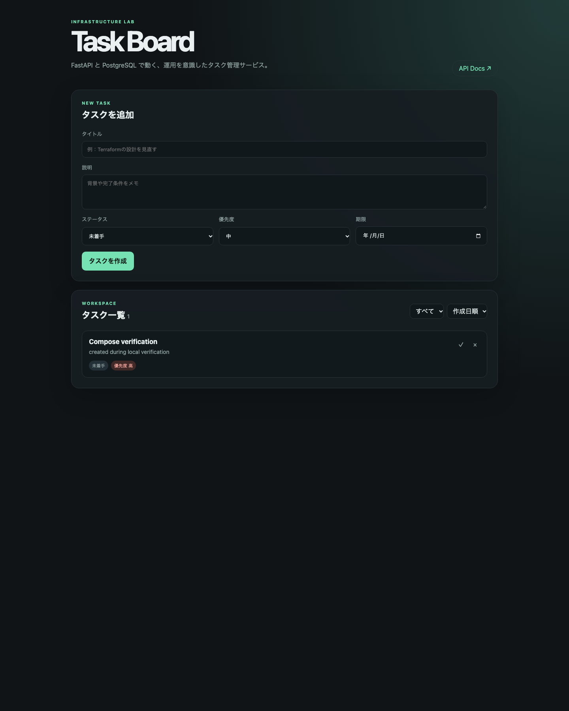

# infra-lab

FastAPI、PostgreSQL、Docker、Terraform、GitHub Actions、Prometheus/Grafanaを組み合わせた、インフラ・SREポートフォリオ

## プロジェクト概要

タスク管理Webサービスを題材に、アプリケーション開発だけでなく、再現可能な環境構築、CI、監視、障害調査を一つのリポジトリで扱えるようにしました。ブラウザのUIからタスクを登録・絞り込み・完了切り替えでき、FastAPIのSwagger UIからREST APIも確認できます。

主な技術：Python / FastAPI / SQLAlchemy 2.x / Alembic / PostgreSQL / Docker Compose / Terraform / GitHub Actions / Prometheus / Grafana

実装した機能：タスクCRUD、ステータス・優先度・期限、検索・フィルタ・ページネーション、ヘルスチェック、構造化ログ、Prometheusメトリクス、ローカルTerraform、AWS向けTerraform、CI、手動実行型のAWS CD設計

> AWS環境へのデプロイ、AWS認証情報の使用、AWSリソースの作成はこの開発では実施していません。AWS部分は構文・静的検証用のコードと手順のみです。

## アーキテクチャ

### ローカル

\`\`\`mermaid
flowchart LR
  Browser --> FastAPI
  FastAPI --> PostgreSQL
  Prometheus -->|/metrics| FastAPI
  Grafana --> Prometheus
\`\`\`

Docker Composeで、FastAPI・PostgreSQL・Prometheus・Grafanaを同一のバックエンドネットワークに配置します。PostgreSQLのデータは名前付きボリュームに保存し、ホストへDBポートを公開しません。

### AWS（未デプロイ）

\`\`\`mermaid
flowchart LR
  Internet --> ALB[Application Load Balancer HTTPS / ACM]
  ALB --> ECS[ECS Fargate private subnets]
  ECS --> RDS[RDS PostgreSQL private subnets]
  ECS --> ECR[Amazon ECR]
  ECS --> Logs[CloudWatch Logs]
  ECS --> Secrets[Secrets Manager]
\`\`\`

ECSタスクとRDSはプライベートサブネット、ALBだけをパブリックサブネットに配置する設計です。プライベートサブネットからECR・CloudWatch Logsへ接続するため、ECR API、ECR DKR、LogsのInterface VPC EndpointとS3 Gateway Endpointを定義しています。NAT Gatewayは使わない構成ですが、VPC Endpoint、ALB、ECS、RDS、ECR、CloudWatch Logsなどにも料金が発生する可能性があります。利用前にAWS公式料金表で確認してください。

### ローカルとAWSの比較

| 観点 | ローカル | AWS設計 |
| --- | --- | --- |
| 実行基盤 | Docker Compose | ECS Fargate |
| DB | PostgreSQLコンテナ | RDS for PostgreSQL |
| 入口 | FastAPIの8000番ポート | HTTPS対応ALB |
| 秘密情報 | \`.env\`（ローカルのみ） | Secrets Manager + GitHub OIDC |
| ログ | Docker標準出力 | CloudWatch Logs |
| メトリクス | Prometheus/Grafana | CloudWatch中心（未実装の運用設定） |
| IaC | Docker Provider | AWS Provider |

アプリケーションコードは環境変数でDB接続先などを切り替え、ローカルとAWSで共通化しています。

## ディレクトリ構成

\`\`\`text
app/                    FastAPI、DB、サービス、UI
alembic/                マイグレーション
tests/                  単体・API統合テスト
docker/                 非root・マルチステージDockerfile
terraform/local/        Docker Providerによる検証環境
terraform/aws/          VPC、ECS、RDS、ALBなどのAWS構成
monitoring/             Prometheus設定とGrafana Provisioning
scripts/                テスト、ローカルデプロイ、Smoke Test
.github/workflows/      CIと安全装置付きAWS CD
\`\`\`

## 必要な開発環境

- Docker Desktop（Compose v2）
- Python 3.12以上
- Terraform 1.6以上（Terraform検証を行う場合）
- Git

AWSアカウント、AWS CLI、AWS認証情報はローカル起動・テストには不要です。

## ローカル環境のセットアップ

\`\`\`bash
cp .env.example .env
docker compose up -d --build
\`\`\`

ブラウザで [http://localhost:8000](http://localhost:8000)、Swagger UIで [http://localhost:8000/docs](http://localhost:8000/docs) を開きます。Grafanaは [http://localhost:3000](http://localhost:3000)、Prometheusは [http://localhost:9090](http://localhost:9090) です。Grafanaの初期認証情報は\`.env\`で変更してください。

停止する場合：

\`\`\`bash
docker compose down
\`\`\`

データを削除する \`docker compose down -v\` は、PostgreSQLと監視のボリュームを消すため、明示的にデータを破棄したい場合だけ実行してください。

## API

| Method | Path | 説明 |
| --- | --- | --- |
| GET | \`/api/tasks\` | 一覧、検索、フィルタ、ページネーション |
| POST | \`/api/tasks\` | タスク作成 |
| GET | \`/api/tasks/{id}\` | 詳細取得 |
| PATCH | \`/api/tasks/{id}\` | 部分更新、完了切り替え |
| DELETE | \`/api/tasks/{id}\` | 削除 |
| GET | \`/health/live\` | プロセスの稼働確認 |
| GET | \`/health/ready\` | DB接続を含む準備状態確認 |
| GET | \`/metrics\` | Prometheus形式のメトリクス |

\`status=todo|in_progress|done\`、\`priority=low|medium|high\`、\`q\`、\`sort_by=priority|due_date|created_at|updated_at\`、\`sort_order=asc|desc\`、\`limit\`、\`offset\`を利用できます。エラーは\`validation_error\`や\`task_not_found\`などのコードを含めたJSONで返します。

## マイグレーション

Compose起動時に \`alembic upgrade head\` が実行されます。手動で実行する場合は、DBが起動した状態で次のコマンドを使います。

\`\`\`bash
docker compose exec app alembic upgrade head
docker compose exec app alembic current
\`\`\`

スキーマ変更はAlembicのrevisionとして管理し、アプリ起動時に自動でテーブルを作成する方式にはしていません。

## 自動テストと品質チェック

ローカルPython環境では次のコマンドを実行できます。

\`\`\`bash
python -m pip install -e ".[dev]"
./scripts/test.sh
\`\`\`

CIではPostgreSQLサービスを使い、Ruff、mypy、Pytest、Docker build、Terraform fmt/validate、tfsecを実行します。テストのデフォルトはSQLiteでも動きますが、CIではPostgreSQLの接続文字列を渡して同じテストを実行します。

## Docker ComposeとTerraformの使い分け

Composeは日常のローカル開発・監視を起動するためのオーケストレーションです。一方、\`terraform/local\`はDocker Providerを使って、ネットワーク、ボリューム、コンテナを宣言的に検証する別ルートです。同じコンテナをComposeとTerraformで同時に管理しないため、状態の競合を避けられます。

\`\`\`bash
terraform -chdir=terraform/local init
terraform -chdir=terraform/local fmt
terraform -chdir=terraform/local validate
terraform -chdir=terraform/local plan
terraform -chdir=terraform/local apply
terraform -chdir=terraform/local destroy
\`\`\`

Docker Providerの初期化・applyはDocker Desktopが起動しているローカル環境でのみ行ってください。

## ローカルデプロイ

\`\`\`bash
./scripts/deploy-local.sh
./scripts/smoke-test.sh
\`\`\`

スクリプトはイメージビルド、DBとアプリの起動、readiness確認、失敗時のログ表示を行います。PostgreSQLの名前付きボリュームは維持されるため、通常の再起動でデータは消えません。

## CIとCD

CIはPull Requestと\`main\`へのpushで実行し、AWS認証情報へアクセスしません。CDはCIと分離し、\`workflow_dispatch\`でのみ起動します。さらに、リポジトリ変数\`AWS_DEPLOY_ENABLED=true\`と、GitHub Environment \`production\`の承認が必要です。初期状態ではこの変数を設定していないため、AWS CDは無効です。

AWS CDを利用する場合は、長期アクセスキーではなくGitHub Actions OIDCでIAMロールを引き受け、ECRへコミットSHAタグのイメージをpushしてECSをローリング更新します。AWSアカウント側のOIDC、IAMロール、Environment保護ルール、変数・Secretは利用者が設定してください。

## AWS Terraform

\`terraform/aws\`には、VPC、2 AZのパブリック・プライベートサブネット、ルートテーブル、Security Group、ECR、ECS Fargate、ALB、RDS、Secrets Manager、CloudWatch Logs、IAM、VPC Endpointを定義しています。

Terraform Stateは機密情報を含み得るため、\`backend "s3" {}\` を用意し、実運用では暗号化・バージョニング・ロック機構を有効にした既存のリモートBackendを\`-backend-config\`で指定してください。Backend用S3/DynamoDB等の作成はこのリポジトリでは行いません。

検証例（AWS接続なし）：

\`\`\`bash
terraform -chdir=terraform/aws init -backend=false
terraform -chdir=terraform/aws fmt -check
terraform -chdir=terraform/aws validate
\`\`\`

AWSへ接続する \`plan\` や \`apply\` は、この開発では実行していません。デプロイ前にはACM証明書ARN、ECRイメージ、リモートBackend、\`TF_VAR_db_password\`などを安全な経路で設定してください。DBパスワードを\`.tf\`や\`.tfvars\`へ書かない設計です。

## 監視・ログ・障害調査

FastAPIはHTTPリクエスト数、ステータスコード別件数、応答時間Histogramを公開します。タスクIDのような無制限のURL値は\`/api/tasks/{id}\`へ正規化し、Prometheusラベルのカーディナリティ増大を避けています。GrafanaはデータソースとダッシュボードをProvisioningし、手動登録なしでリクエストレート、エラー率、p95レイテンシを表示します。

アプリログはJSON形式で標準出力へ出し、タイムスタンプ、レベル、リクエストID、HTTPメソッド、パス、ステータス、処理時間を含めます。パスワードやDB接続文字列はログへ出しません。障害時は、\`/health/live\`、\`/health/ready\`、Composeログ、Prometheusのエラー率・p95を順に確認します。AWS版では標準出力をCloudWatch Logsへ送る構成です。

## セキュリティ上の設計判断

- \`.env\`、Terraform State、tfvars、DBデータ、ログをGit管理から除外。
- \`.env.example\`にはダミー値のみを記載。
- SQLAlchemyのバインドパラメータとPydanticの長さ・列挙値検証を使用。
- CORSの許可元を環境変数で制御し、不要なHTTPメソッドを許可しない。
- FastAPIコンテナは非rootユーザーで実行し、PostgreSQLポートは公開しない。
- AWSではALBのHTTPSを前提にし、ECS/RDSをプライベートサブネットへ配置。
- ECS Task Execution RoleとTask Roleを分離し、Secrets Manager参照権限をExecution Roleに限定。
- AWS CDはOIDC、手動実行、Environment承認、リポジトリ変数の二重安全装置を使用。

ローカルUI/APIは学習・検証用の認証なし構成です。AWS版を外部公開する場合は、ALBの前段に認証・認可（例：企業IdP連携またはCognito等）を追加するまで公開範囲を制限してください。認証なしのまま本番公開できる設計とは扱っていません。

## トラブルシューティング

### アプリが起動しない

\`\`\`bash
docker compose ps
docker compose logs --tail=100 app db
curl http://localhost:8000/health/ready
\`\`\`

### Grafanaにデータが出ない

PrometheusのTargetsで\`app:8000\`がUPか、\`curl http://localhost:8000/metrics\`でメトリクスが出るかを確認します。Composeのサービス再作成が必要な場合は\`docker compose up -d --force-recreate prometheus grafana\`を実行します。

### TerraformのProviderを取得できない

\`terraform init\`はProvider Registryへ接続します。ネットワーク制限下では、CIまたはネットワークが利用できる環境でProviderを取得してください。AWS Terraformの検証では、AWS認証情報なしで\`init -backend=false\`と\`validate\`までを行います。

## 検証状況

| 項目 | 状況 |
| --- | --- |
| Composeでのローカル動作 | 確認済み（healthy） |
| API/UI | 確認済み（スモークテスト・ブラウザ） |
| PostgreSQL永続化 | 確認済み（再起動後も保持） |
| テスト・Lint・型チェック | 確認済み（6 tests passed / 96% coverage） |
| Prometheus/Grafana | 確認済み（target up / dashboard provisioned） |
| Docker Provider | 確認済み（apply・smoke test・destroy） |
| AWS Terraform | AWS APIへ接続せず、fmt/init/validate/tfsecのみ |
| AWSデプロイ | 未実施 |

## 今後の改善案

- AWS版の認証・認可をCognitoまたは既存IdPと接続する。
- AWS CloudWatch Dashboard、Alarm、通知経路をTerraformで追加する。
- DBバックアップの復元演習と、ECSデプロイ失敗時の自動ロールバック検証を追加する。
- PlaywrightなどによるブラウザE2Eテストを追加する。
- Rate Limit、監査ログ、CSRF対策など、外部公開時の防御を強化する。

## ライセンス

MIT License
